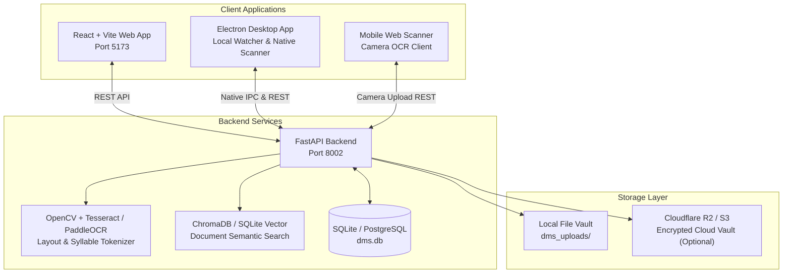

# DOKA AI DMS — Master Roadmap & Systematic Execution Plan

**Project Type:** Standalone AI-Powered Document Management & OCR Suite  
**Platforms:** Vite/React Web App (`http://localhost:5173`), FastAPI Backend (`http://localhost:8002`), Electron Native Desktop App  
**Status:** In Active Development & Local Verification  
**Language Specification:** English (Standard Technical Documentation)  
**Last Updated:** October 2026  

---

## 1. System Architecture & Topology

DOKA AI DMS provides a zero-leakage, multi-platform document intelligence system supporting:
`Document Ingestion → OCR Preprocessing & Layout Analysis → Text Extraction (Burmese & English) → Vector Embedding & RAG → Rule Matching & Tagging → Granular Folder RBAC → Audit Trail & Long-Term Archival`.

---

## 2. Completed Milestones & Operational Proofs

- [x] **Decoupled Standalone Infrastructure:** Assigned dedicated ports (Web: 5173, API: 8002).
- [x] **Database & ORM Stabilization:** Configured absolute SQLite path `Office_DMS/database/dms.db`, established full ORM tables (Users, Documents, Folders, Permissions, SOP Templates, Rules, Audit Logs), and seeded initial admin credentials (`admin` / `admin123`).
- [x] **Backend API & Health Verifications:** FastAPI `/health` endpoint operational (HTTP 200 OK). Mounted routers for documents, templates, rules, permissions, audit, and brain_soul.
- [x] **Advanced OpenCV OCR Preprocessing:** Integrated deskewing, Contrast Limited Adaptive Histogram Equalization (CLAHE), adaptive binarization, and Tesseract TSV bounding box parser with Myanmar Unicode syllable normalization.
- [x] **Web Frontend Platform:** Built complete document management interface, document previewer with OCR bounding box overlay, and routed admin pages (`/admin/templates`, `/admin/rules`, `/admin/permissions`, `/admin/audit`). Frontend production build verified (passing in 9.02s).
- [x] **Desktop Native Client:** Built Electron desktop application (`apps/desktop`) with native system tray, menu bindings, and multi-window shell.
- [x] **Mobile Camera Scanner:** Added camera capture and upload workflows in `UploadScreen.js`.

---

## 3. Comprehensive Remaining Tasks (Consolidated from Legacy Backlogs)

### Priority 1: OCR Pipeline & Multi-Language Accuracy
- [ ] **Dual-Engine Benchmark:** Implement automatic fallback between local Tesseract OCR (with `mya` + `eng` language packs) and PaddleOCR for degraded scans.
- [ ] **Batch PDF Multi-Page OCR Queue:** Build asynchronous background worker to process large multi-page PDF documents page-by-page with live progress updates.
- [ ] **Bounding Box Interactive Correction:** Allow users to adjust, resize, or delete OCR bounding boxes and edit recognized text directly in the Web Previewer canvas.

### Priority 2: Storage Routing & Hybrid Cloud Modes
- [ ] **Storage Routing Execution:** Implement deterministic fallback between `STORAGE_PROVIDER=local`, `STORAGE_PROVIDER=r2`, and `STORAGE_PROVIDER=hybrid`.
- [ ] **SHA-256 Checksum Immutability:** Verify automated document hash generation on upload and reject corrupted or tampered file revisions.
- [ ] **Automated Backup & Retention Schedule:** Enforce configurable retention policies, automated document archiving, and one-click database export/restore.

### Priority 3: Desktop Native File Watcher & Mobile Integration
- [ ] **Native Electron Folder Watcher:** Connect Node.js `chokidar` folder watcher in Electron to auto-detect and upload newly added local files to the backend.
- [ ] **Desktop Native Offline Mode:** Enable local SQLite cache synchronization so desktop users can view cached document indexes while offline.
- [ ] **Mobile Document Scanner Enhancements:** Add automatic document edge detection, perspective warping, and auto-crop before uploading.

### Priority 4: Rules Engine & Automated Compliance
- [ ] **Rule Action Execution:** Wire up the rule manager to automatically apply tags, move documents to target folders, and dispatch webhook notifications when OCR keywords match.
- [ ] **Granular Folder Permissions Enforcement:** Enforce user role permissions (`read`, `write`, `admin`, `none`) across document download, rename, and delete endpoints.
- [ ] **Comprehensive Audit Trail Reporting:** Provide CSV/PDF export of document access history, user login events, and administrative configuration changes.

### Priority 5: Security Hardening & E2E Validation
- [ ] **Multi-Tenant / Multi-User Isolation Tests:** Execute automated integration tests verifying complete data isolation between regular users and administrative roles.
- [ ] **End-to-End Cypress / Playwright Regression:** Automate cross-browser and Electron E2E test suites covering file upload, OCR extraction, search, and permission enforcement.

---

## 4. Next Systematic Steps

1. **Step 1:** Run `verify_all_backends.py` and frontend test suite to ensure backend route coverage is 100% verified.
2. **Step 2:** Test Electron desktop app folder watcher connection with backend file import endpoint.
3. **Step 3:** Perform live multi-page PDF batch OCR extraction test.

## 5. Release Gates and Evidence Status

The following gates are tracked explicitly so repository checks cannot mistake implementation notes for production acceptance. Gates remain **pending** until their required evidence is recorded; passing CI alone does not close them.

- **Gate 3 — Release readiness:** current release gate report and explicit readiness evidence.
- **Gate 4 — Regression acceptance:** maintained backend/frontend regression suites pass.
- **Gate 5 — Source integrity:** source immutability and recovery verification evidence.
- **Gate 6 — Recovery objectives:** recovery test and measured RTO evidence.
- **Gate 8 — Prerequisite gates:** Gates 1–7 are accepted with evidence.
- **Gate 9 — Authenticated cloud acceptance:** live cloud acceptance run, including its gate readiness and two-user isolation result.
- **Gate 10 — Tenant isolation:** distinct staging User A/User B tests prove cross-user data is not exposed.
- **Gate 11 — Provider recovery:** evidence covers Supabase Storage, B2 recovery, Cloudinary application path, Google Drive recovery, and the exact 50 MiB boundary.
- **Gate 12 — Production sign-off:** explicit sign-off after Gates 8–11 are evidenced; this is not inferred from CI.

### Immediate release blockers

- [ ] Re-run all CI workflows after the latest remediation and resolve any remaining failures.
- [ ] Deploy the Worker changes to staging first; verify health, API configuration, and production-vs-preview CORS behavior.
- [ ] Run authenticated staging isolation and provider recovery acceptance with distinct staging-only credentials.
- [ ] Verify the production Worker and Vercel deployment after controlled release; record evidence before marking Gate 12 complete.
- [ ] Confirm GitHub Actions secrets and Render service inventory; do not claim live acceptance when credentials or a service are unavailable.
